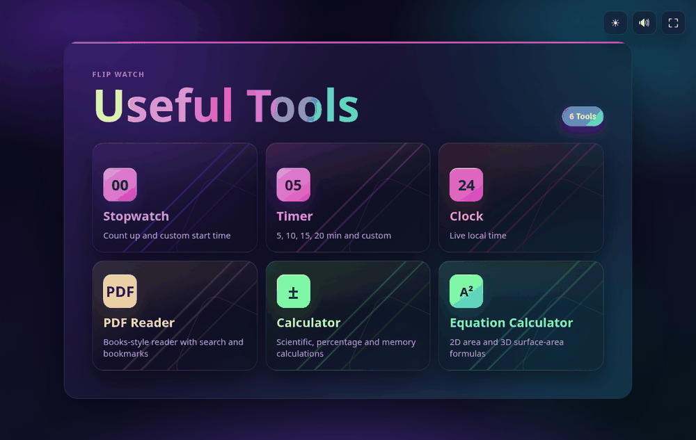
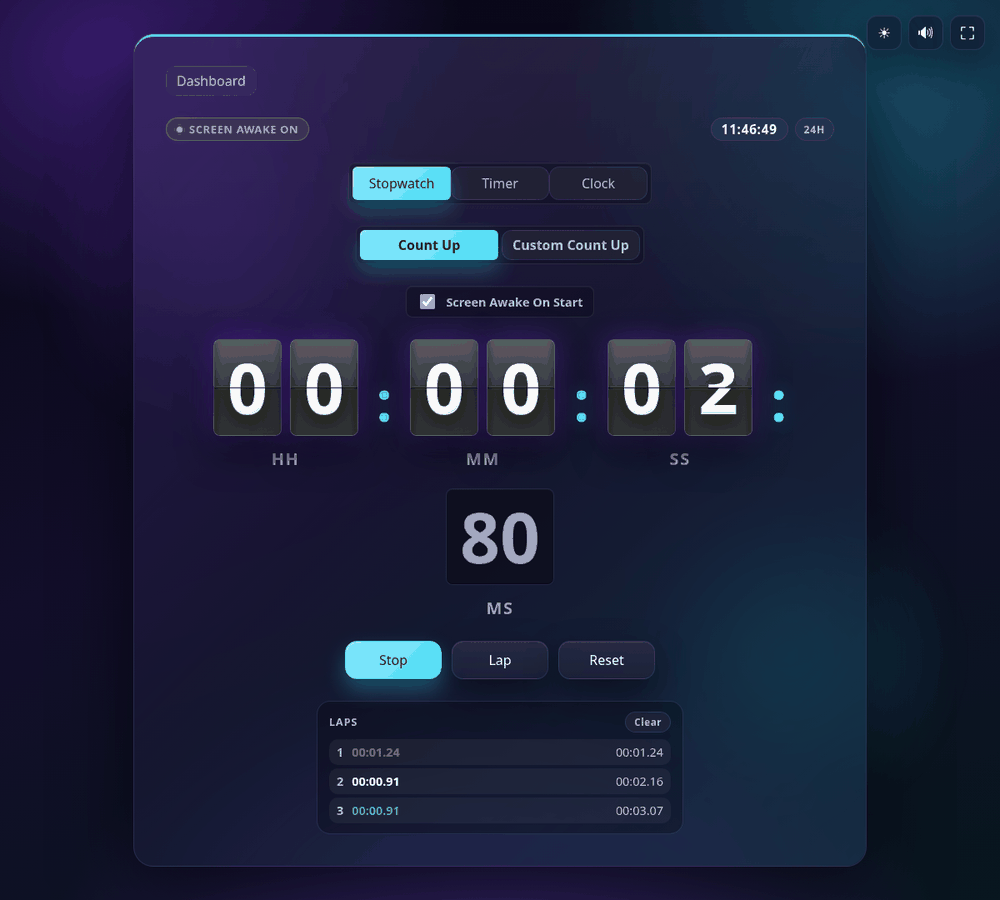
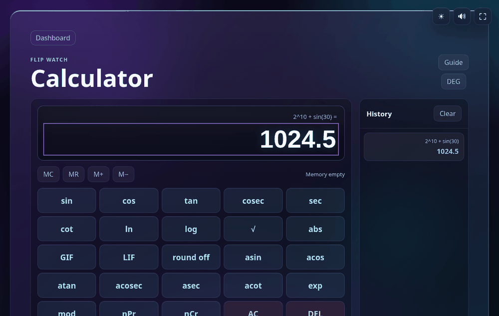
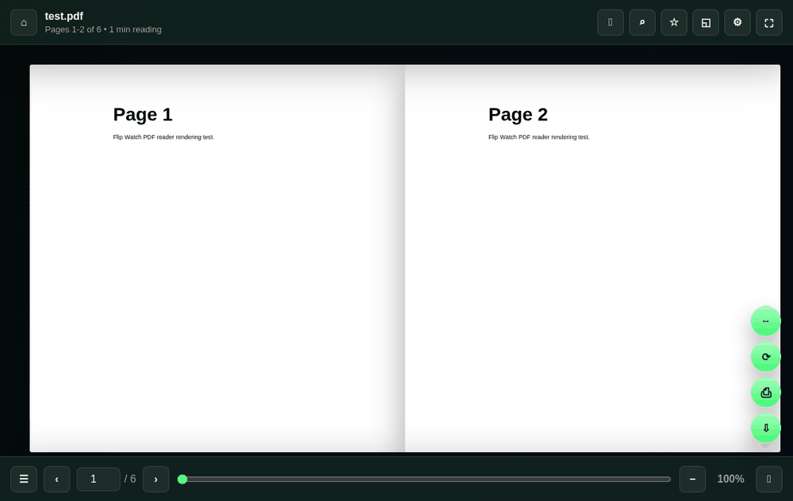

<div align="center">

# ⏱️ Flip Watch

**A polished, offline-ready suite of everyday tools — built with plain HTML, CSS and JavaScript.**

[](https://542bheemsingh-cmd.github.io/Flip-watch/)
[](https://542bheemsingh-cmd.github.io/Flip-watch/)
[](#tech-stack)



</div>

---

## ✨ What's inside

Flip Watch is a single-page web app that opens into a dashboard of eighteen tools. Every tool shares the same design system: an animated flip clock, light/dark themes, and a colour palette that slowly drifts through the spectrum.

| Tool | What it does |
| --- | --- |
| ⏱️ **Stopwatch** | Count up or start from a custom time, with **laps/splits** (best & worst highlighted) |
| ⏲️ **Timer** | 5 / 10 / 15 / 20 minute presets and any custom duration up to 99 h |
| 🕐 **Clock** | Live local time with a **12/24-hour switch** and a live time readout in the toolbar |
| 📖 **PDF Reader** | Book-style reader with a realistic page turn, search, bookmarks, contents, night mode |
| 🧮 **Calculator** | Scientific functions, memory, percentages, factorials and a persistent history |
| 📐 **Equation Calculator** | 2D area / perimeter and 3D surface-area / volume formulas, plus function graphs |
| 🔁 **Unit Converter** | Length, weight, temperature, area, volume, speed, time and data — plus a same-value-in-every-unit table |
| 🔑 **Password Generator** | Random passwords or memorable passphrases, entropy meter, copy button |
| 🔤 **Word Counter** | Words, characters, reading time, top keywords and case tools |
| ✅ **To-Do List** | Tasks with due dates, filters and inline editing, saved in the browser |
| 📅 **Date Calculator** | Age, days between two dates (with business days), or adding days to a date |
| 🧾 **GST Calculator** | Add or remove GST (0.25–28%) with the CGST/SGST split |
| 🏦 **EMI Calculator** | Monthly EMI, total interest and total payment for a loan |
| ⛽ **Fuel Cost** | Trip fuel needed and cost, split between people |
| { } **JSON Formatter** | Format, minify and validate JSON, with the error line and column |
| 🔐 **Base64, URL & Hash** | Encode/decode Base64 and URLs, and SHA-256 hash text offline |
| 🎨 **Colour Toolkit** | HEX/RGB/HSL conversion, tints and shades, WCAG contrast check |
| 🎲 **Random Picker** | Random number, dice, coin flip, or a name from a list |

<div align="center">


</div>

---

## 🚀 Highlights

- **Installable PWA** — add it to your home screen and use it with no network.
- **Offline first** — a service worker caches the app shell and refreshes it in the background.
- **Light & dark themes** — one click, remembered between visits.
- **Living colour** — accents drift slowly through different hues on every screen.
- **Laps, not just a timer** — split and total times, with the best and worst lap highlighted.
- **Everything is remembered** — calculator history, memory, timer presets and even a paused stopwatch survive a reload.
- **Keyboard first** — `Space` start/pause, `R` reset, `L` lap, arrow keys inside every segmented control.
- **Accessible** — visible focus, correct ARIA state, and focus moves into a tool when you open it.
- **Truly responsive** — designed for phones as much as desktops, including the PDF reader.

---

## 📖 PDF Reader

The reader is a full sub-app of its own (`/pdf-reader/`):

<div align="center">

</div>

- **Realistic book mode** with a purpose-built CSS-3D page flip (no page is ever blank mid-turn).
- **Continuous, single-page and horizontal** layouts, fit-width / fit-page, zoom and rotation.
- **Search** across the document, **bookmarks**, and a **table of contents** from the PDF outline.
- **Night mode**, brightness, UI font size and high contrast.
- **Your files never leave the device** — everything is parsed locally; recent files are stored in IndexedDB.

> Large files (> 25 MB) are not stored for reopening, to protect your browser's storage quota.

---

## ⌨️ Keyboard shortcuts

| Keys | Action |
| --- | --- |
| `Space` | Start / pause the stopwatch or timer |
| `R` | Reset |
| `L` | Record a lap (stopwatch only) |
| `←` `→` `↑` `↓` | Move between buttons in a segmented control |
| `Home` / `End` | Jump to the first / last button in a group |
| `Enter` / `Escape` | Confirm / close inside the calculator |

---

## 🧱 Tech stack

| Layer | Choice |
| --- | --- |
| Markup & style | Hand-written HTML5 and modern CSS (custom properties, `@property`, container-free grid) |
| Logic | Vanilla JavaScript (ES modules), no framework and no build step |
| PDF engine | [pdf.js](https://mozilla.github.io/pdf.js/) v6 (vendored) with compatibility polyfills |
| Page flip | A small custom CSS-3D engine (`pdf-reader/js/book-flip.js`) |
| Offline | Service worker + web app manifest |
| Hosting | GitHub Pages |

---

## 📁 Project structure

```text
Flip-watch/
├── index.html              # Dashboard + stopwatch / timer / clock / calculator / equations
├── styles.css              # Design system, themes, layout, colour cycle
├── script.js               # All dashboard logic
├── service-worker.js       # Offline cache
├── manifest.json           # PWA manifest
├── og-image.png            # Social share image (1200×630)
├── 404.html                # Branded not-found page
├── assets/                 # Screenshots used in this README
└── pdf-reader/
    ├── index.html
    ├── css/                # style, theme, reader, animations
    ├── js/
    │   ├── app.js          # Reader bootstrap
    │   ├── viewer.js       # PDF viewport, rendering, navigation
    │   ├── book-flip.js    # Custom realistic page-flip engine
    │   ├── pdf-polyfills.js# Compatibility polyfills for pdf.js v6
    │   └── …               # search, bookmarks, toc, thumbnails, settings
    └── vendor/             # pdf.js, GSAP, Hammer, page-flip (legacy)
```

---

## 🖥️ Run it locally

The app is fully static, but the PDF reader and the service worker need to be served over HTTP (not `file://`).

```bash
git clone https://github.com/542bheemsingh-cmd/Flip-watch.git
cd Flip-watch

# any static server works
python3 -m http.server 8000
# then open http://localhost:8000
```

---

## 🌐 Browser support

Flip Watch targets current Chrome, Edge, Safari and Firefox. Because pdf.js v6 relies on a few very new JavaScript APIs, `pdf-reader/js/pdf-polyfills.js` is loaded before it (and its contents are also embedded in the PDF worker) so the reader works on WebKit and older engines too.

---

## 🤝 Contributing

Contributions are welcome — see [CONTRIBUTING.md](CONTRIBUTING.md). Bug reports and feature ideas are best raised as [issues](https://github.com/542bheemsingh-cmd/Flip-watch/issues).

---

## 🙏 Credits

- [pdf.js](https://mozilla.github.io/pdf.js/) — PDF parsing and rendering.
- [GSAP](https://gsap.com/) and [Hammer.js](https://hammerjs.github.io/) — bundled with the reader.
- Photo credits for the original background imagery: see [IMAGE-CREDITS.md](IMAGE-CREDITS.md).

---

## 📄 License

No license file has been added to this repository yet, so the code remains © the author with all rights reserved. If you would like others to reuse it, adding an [MIT](https://choosealicense.com/licenses/mit/) license is a common choice.
